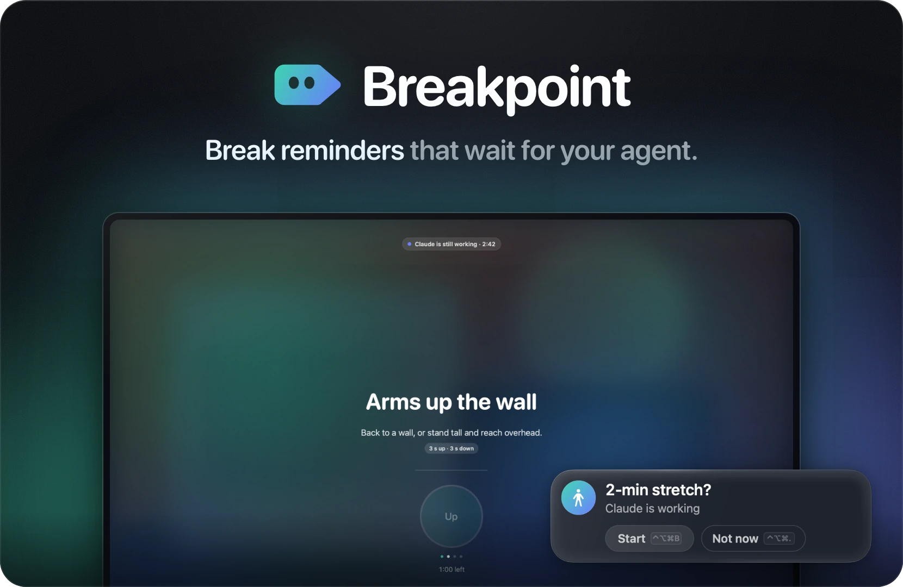

<p align="center">
  
</p>

<p align="center">
  <a href="https://github.com/estrindavid/breakpoint/releases/latest"></a>
  
  
  <a href="https://github.com/estrindavid/breakpoint/actions/workflows/release.yml"></a>
  <a href="https://github.com/estrindavid/breakpoint/actions/workflows/ci.yml"></a>
</p>

<p align="center">
  A Mac menu-bar app for people who code with AI agents.<br>
  It offers a short break while your agent works, and calls you back when it needs you.
</p>

<br>

<p align="center">
  
</p>

<br>

<h2 align="center">Get Breakpoint</h2>

<p align="center">Paste this in Terminal. It installs the latest release into Applications.</p>

```sh
curl -fsSL https://github.com/estrindavid/breakpoint/releases/latest/download/install.sh | bash
```

<p align="center">
  <sub>macOS 14 or later · no account · free </sub>
</p>

<br>

<details>
<summary><b>Install and updates</b>: what the installer does, and why it isn't signed by Apple</summary>
<br>

The installer ([`scripts/install.sh`](scripts/install.sh)) downloads the latest release,
checks its size and SHA-256 against the release's feed, and puts Breakpoint in `/Applications`
(or `~/Applications` when `/Applications` isn't writable). It opens nothing and asks for no
password; open Breakpoint from Applications or Spotlight. The checksum comes from the same release
as the zip, so it catches a broken download, not a tampered release: like any `curl | bash`, it
trusts this repository's releases.

**Not signed by Apple.** Breakpoint has no Apple Developer ID and isn't notarized; it is signed
ad hoc. Files fetched with `curl` carry no quarantine flag, so macOS opens it without the
"unidentified developer" dialog. If you download the zip from the
[latest release](https://github.com/estrindavid/breakpoint/releases/latest) in a browser instead,
macOS blocks the first open: move Breakpoint to Applications, open it once, then go to
System Settings → Privacy & Security and click **Open Anyway**.

**Updates** come by themselves. At a quiet moment, at most once a day, a small card says
"Breakpoint 0.3.0 is ready" with Later and Update. Update downloads the new version, checks its
size, SHA-256 and signature (the project's own Ed25519 release key, not Apple's), replaces the app
and reopens it; settings and history stay. Older versions are never installed over newer ones.
Settings → About has Check now, and switches for automatic checks and automatic installs. A copy
built without the release key only tells you about a new version and opens its download page.
Maintainers: [docs/RELEASING.md](docs/RELEASING.md).

</details>

<details>
<summary><b>Connect a coding agent</b>: Claude Code, Cursor, Codex CLI, Copilot CLI, Gemini CLI, your shell</summary>
<br>

In onboarding, or Settings → Integrations, press **Install** next to your tool. Breakpoint backs
up that tool's user settings file, adds a few marked hooks, and copies its command-line tool to
`~/.breakpoint/bin/breakpoint`, which the hooks call. Then it checks, by itself, that the hooks'
command reaches the app, and the row shows ✓ Connected; if something is in the way, the row says
what and what to do. **Remove** takes out only what Breakpoint added and restores the file exactly.

| Tool | What Install writes | Good to know |
|---|---|---|
| Claude Code | hooks in `~/.claude/settings.json` | hooks run once you trust the workspace |
| Cursor | hooks in `~/.cursor/hooks.json` | Cursor has no "needs you" signal |
| Codex CLI | hooks in `~/.codex/hooks.json` (or `$CODEX_HOME`) | trust the new hooks once: open `/hooks` in Codex |
| Codex, older versions | one marked `notify` line in `~/.codex/config.toml` | Options… → Use legacy notify |
| Copilot CLI | its own file, `~/.copilot/hooks/breakpoint.json` | |
| Gemini CLI | hooks in `~/.gemini/settings.json` | older versions may have hooks turned off |
| Your shell | `~/.breakpoint/shell/`, sourced from a marked block in `.zshrc`, `.bashrc` and `.bash_profile` (fish: `conf.d`) | offers breaks while a long command runs; sends only the command's first word |

The same from a terminal:

```sh
B=/Applications/Breakpoint.app/Contents/Helpers/breakpoint   # or build/Breakpoint.app/…
$B install claude-code        # claude-code | cursor | codex | codex-notify | copilot | gemini | shell | all
$B status                     # what the app knows right now (JSON)
$B status --line              # the same as one short line (see "In your terminal")
$B doctor                     # socket, app, CLI copy, each integration, and the signals the app reads
```

Any other tool can report itself:

```sh
~/.breakpoint/bin/breakpoint emit agentStarted --source my-tool --session ID
~/.breakpoint/bin/breakpoint emit agentFinished --source my-tool --session ID
```

`emit` prints nothing and always exits 0, so a hook can never break your tool. Events travel over a
local Unix socket that only your user can open: no HTTP server, no port.

</details>

<details>
<summary><b>In your terminal</b>: one line for Claude Code's status bar, your prompt or tmux</summary>
<br>

`breakpoint status --line` prints what the menu bar knows as one short line, and nothing at all
when the app isn't running:

```text
eye rest in 12 min · Claude working 3 min
2-min stretch? · Claude working 4 min
stretch 1:20 left · Claude needs you
paused: microphone is on · 1 needs you · 2 working
```

**Claude Code**: in `~/.claude/settings.json` (if you already have a `statusLine`, call this from
your script instead):

```json
"statusLine": { "type": "command", "command": "~/.breakpoint/bin/breakpoint status --line --color" }
```

**zsh** (in `~/.zshrc`): `setopt prompt_subst; RPROMPT='$(~/.breakpoint/bin/breakpoint status --line)'`

**tmux** (in `~/.tmux.conf`): `set -g status-right '#(~/.breakpoint/bin/breakpoint status --line)'`

It answers in a few milliseconds and never waits more than a quarter of a second. On a terminal
it takes the app's colours; `--color` keeps them when the output goes through a pipe, as in
Claude Code (leave it off for prompts and tmux, which don't read colour codes from a command).

</details>

<details>
<summary><b>Privacy and permissions</b>: what it reads, and what it never does</summary>
<br>

**It never** takes screenshots or records the screen, reads what you type (the optional shell
integration sends only the first word of each command you run), reads window titles,
lists the apps or websites you use, or sends anything about you anywhere. There is no account and
no analytics.

**No permission prompt** for any core feature: no Accessibility, Input Monitoring, Screen
Recording, Calendar, Focus, Notifications, Camera or Microphone access. The one prompt in the app
belongs to an optional, experimental AirPods movement check (off by default), shown only when you
turn it on.

**What it reads**, all without a prompt: seconds since the last key press, scroll or input (not
which key), whether a mouse button is down, whether any microphone or camera is in use (on or off,
never which app), lock, sleep and screen-saver state, whether something is keeping the display
awake (a count, no app names) and whether a display is mirrored, and where the pointer is (to pick
the display for a pop-up).
`Breakpoint.app/Contents/MacOS/Breakpoint --signals`, or `breakpoint doctor` while the app runs,
prints every signal and the decision it leads to.

**On the network**: at most once a day, one download of a small public file
(`update-feed.json` from this repository's latest release) with no cookies or credentials; GitHub
sees the IP address, time and app version. The new version itself is downloaded only when you
install it. Settings → About turns the check off.

**Prompt snippets** (the first line of your prompt and of the agent's last reply, to label
sessions and resume cards; words that look like secrets are masked) are kept in memory only, and
only while Settings → Privacy → Keep prompt snippets is on. Settings → Privacy also has Export
history and Delete all data.

</details>

<details>
<summary><b>Build from source</b>: Command Line Tools only, no Xcode</summary>
<br>

Requirements: macOS 14 or later, and Apple's Command Line Tools (`xcode-select --install`).
`jq` is needed for `scripts/e2e.sh` only (macOS 15 and later include `/usr/bin/jq`).

```sh
scripts/build-app.sh          # release build → build/Breakpoint.app (with the CLI inside)
open build/Breakpoint.app     # or scripts/run.sh, which builds, quits a running copy and opens it
```

The first launch shows a short onboarding. Then Breakpoint lives in the menu bar: click the mark
for the popover (next break, agents, today), right-click for Take a break, Pause, Settings and
Quit. Open at login works once the app is in `/Applications` (a build folder is replaced on every
build, so Breakpoint never registers a copy there).

Every break screen can be played with sample data; it records nothing and quits when it's over
(Esc Esc closes an overlay):

```sh
APP=build/Breakpoint.app/Contents/MacOS/Breakpoint
$APP --demo list              # every scenario with a one-line description
$APP --demo flow              # nudge → stretch → agent finishes → Done → resume card
$APP --demo needs-you         # the chime, amber chip and Back to work
$APP --demo wind-down         # the stop-time card: hold for 15 more minutes, or Wrap up
```

</details>

<details>
<summary><b>Data and where it lives</b></summary>
<br>

| Where | What |
|---|---|
| `~/Library/Application Support/Breakpoint/settings.json` | your settings |
| `…/history.jsonl` | one line per offer or break (kind, outcome, when, how long), shown as a calm daily record |
| `…/sessions.json` | the last 20 run lengths per tool, for "Claude usually takes 4 min" |
| `…/integrations.json` | what Install created or found empty, so Remove restores files exactly |
| `…/updates.json` | when the update check last ran and the newest version it saw |
| `…/backups/` | a copy of each tool settings file taken before Breakpoint edited it |
| `…/breakpoint.sock`, `…/watchdog.log` | the local socket the hooks write to; a line per watchdog restart |
| `~/.breakpoint/bin/breakpoint`, `~/.breakpoint/shell/` | the CLI copy the hooks call; the shell snippets |

</details>

<details>
<summary><b>Uninstall</b></summary>
<br>

Remove the hooks first, while `integrations.json` still exists, so every file goes back to exactly
how it was:

```sh
~/.breakpoint/bin/breakpoint uninstall all
```

Then turn off Settings → General → Open at login, quit Breakpoint, and delete what it wrote:

```sh
rm -rf ~/.breakpoint "$HOME/Library/Application Support/Breakpoint"
rm -rf /Applications/Breakpoint.app        # or build/Breakpoint.app
```

</details>

<details>
<summary><b>Contributing</b></summary>
<br>

Pull requests are welcome. [CONTRIBUTING.md](CONTRIBUTING.md) says how to build and test, what a
review checks, and how a change gets in; report security problems privately as
[SECURITY.md](SECURITY.md) describes.

A Swift package with no third-party dependencies. [docs/SPEC.md](docs/SPEC.md) is the single
source of truth for behaviour and design; [CLAUDE.md](CLAUDE.md) holds the working notes,
[docs/INTERFACES.md](docs/INTERFACES.md) the seams between parts, and
[docs/TRYING-IT.md](docs/TRYING-IT.md) a first walk-through.

```sh
swift build
scripts/test.sh               # unit tests (Swift Testing)
scripts/snapshots.sh          # every screen → build/snapshots/
scripts/e2e.sh                # the whole app, driven through the CLI with nothing on screen
```

`scripts/e2e.sh` must pass after every change. Set `BREAKPOINT_HOME=/some/folder` to run the app
or CLI against a stand-in home folder, so your real agent settings are never touched. Copy in the
app is plain and second person, with no medical claims and no streaks or scores.

</details>

<br>

## License

Free to use, including at work. You may read, change and share the code. You may not use it to
provide a product that competes with Breakpoint. The full terms are the
[PolyForm Shield License 1.0.0](LICENSE.md); Breakpoint is source-available rather than
"open source" in the OSI sense. Contributions are welcome under the terms in
[CONTRIBUTING.md](CONTRIBUTING.md#licensing-of-contributions).

<p align="center">
  <sub>Breakpoint · break reminders that wait for your agent</sub>
</p>
